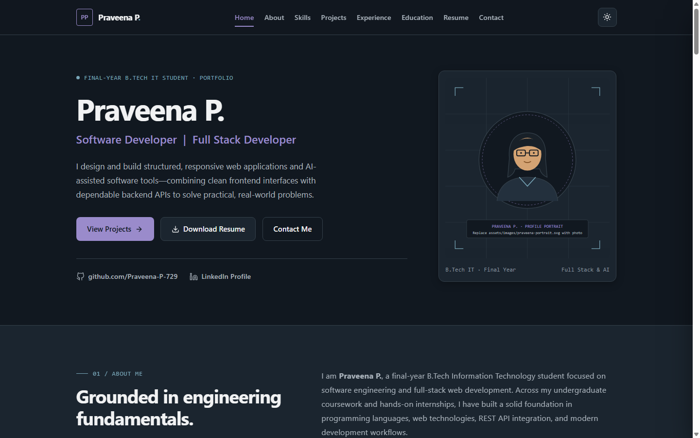
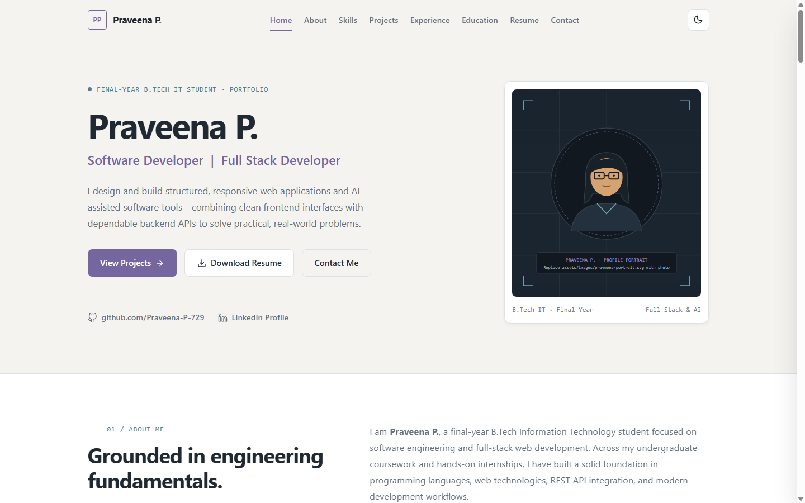
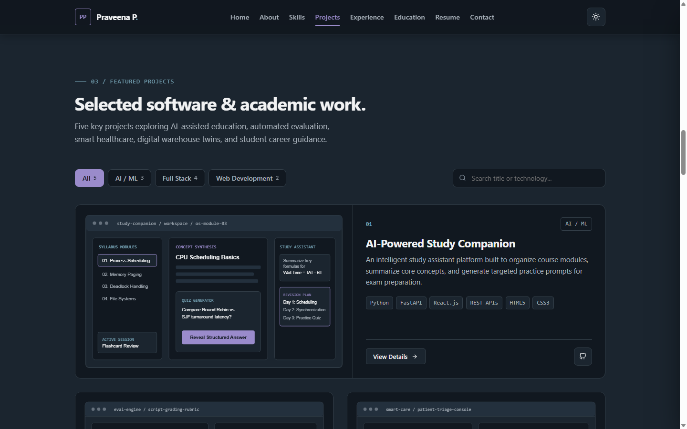
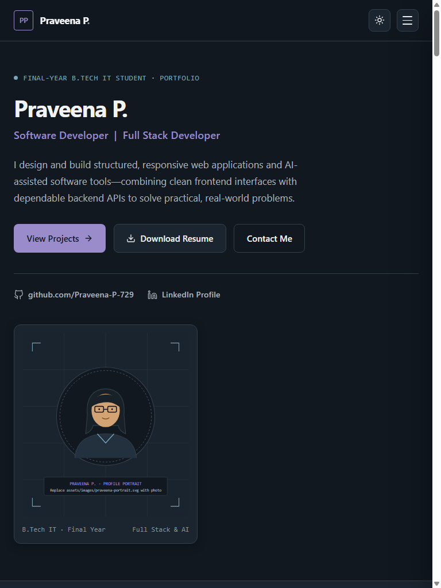
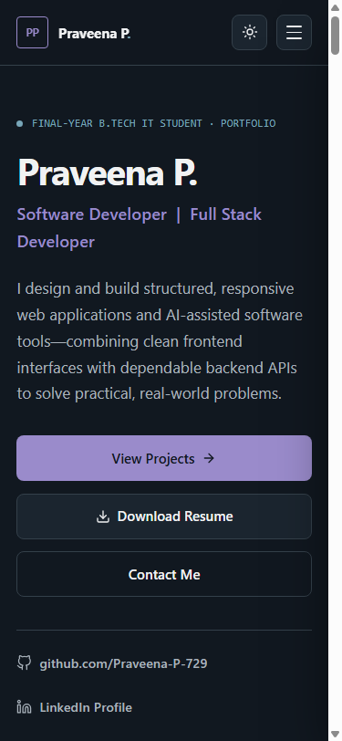

# Praveena P. — Personal Developer Portfolio & Project Showcase

> **Datheon Full Stack Web Development Internship — HTML5 Task 1**  
> **Author:** Praveena P. (`Software Developer | Full Stack Developer`, Final-Year B.Tech IT Student)  
> **GitHub Repository:** `https://github.com/Praveena-P-729/Datheon_Full_Stack_Web_Development_Internship` *(Update after creating & pushing the repository)*  
> **Live Website URL:** *Pending deployment — follow the deployment steps below to publish on GitHub Pages, Vercel, or Netlify*

---

## 1. Project Introduction

This repository contains the source code for the personal developer portfolio of **Praveena P.**, built for the **Datheon Full Stack Web Development Internship – HTML5 Task 1**.

Designed with an editorial, typography-first layout and restrained dual-theme color system, the website professionally showcases Praveena's identity, technical skills, five academic and full-stack software projects, internship experience at **CodeAlpha** and **SkillCraft Technology**, educational background, resume, and contact channels.

It is engineered purely with semantic **HTML5**, modern **CSS3** (Flexbox, CSS Grid, Custom Properties), and modular **Vanilla JavaScript (ES6+)** with zero unnecessary external frameworks.

---

## 2. Key Features

- **Editorial Dual-Theme System (Dark & Light)**:
  - **Dark Theme**: `#111820` primary canvas, `#1B252F` secondary surface, `#9A8BCB` primary accent, `#78A6B8` secondary accent, `#F1F2F3` crisp text.
  - **Light Theme**: `#F4F3F0` warm paper canvas, `#FFFFFF` secondary surface, `#75669F` primary accent, `#527E90` secondary accent, `#202832` crisp text.
  - Theme preference persists across reloads using `localStorage`, applied synchronously before first paint to avoid theme flashing.
- **Responsive Mobile-First Navigation**:
  - Clean desktop header with PP monogram and active ScrollSpy section highlighting (`IntersectionObserver`).
  - Accessible slide-in mobile drawer (`< 1024px`) with backdrop, `Escape` key dismiss, focus management, and automatic closing when selecting a section.
- **Dynamic Featured Projects Showcase**:
  - Displays all 5 projects in an asymmetrical editorial layout (featured horizontal split + 2-column grid).
  - Real-time category filtering (`All`, `AI / ML`, `Full Stack`, `Web Development`) with live item counts.
  - Live keyword search across project titles, descriptions, and technology tags, with an informative empty-state fallback.
  - Interactive, keyboard-accessible **Project Detail Modal** (`Escape` close, backdrop click close, focus trap & focus restoration).
- **Organized Technical Skills Matrix**:
  - Categorized across Frontend Development, Backend Development, Programming Languages, Databases, Development Tools, and AI Technologies with uniform SVG icons and no arbitrary skill percentage bars.
- **Internship Experience & Education**:
  - Editorial rows detailing responsibilities, tools, and skills gained at **CodeAlpha** and **SkillCraft Technology**.
  - Dedicated academic credentials section for final-year B.Tech Information Technology studies and editable certification slots.
- **Resume Preview & PDF Download**:
  - Structured inline resume summary preview alongside a working PDF download (`assets/resume/Praveena_P_Resume.pdf`) and print view styles (`@media print`).
- **Validated Contact Form & Direct Channels**:
  - One-click email clipboard copy with toast feedback, plus GitHub and LinkedIn profile links.
  - Client-side validation for Name, Email, and Message with accessible inline error messages.
  - Honest static-site disclosure: validated submissions compose a prefilled `mailto:` draft in your email client rather than falsely claiming server-side delivery.
- **Accessibility & Performance**:
  - Semantic landmarks (`<header>`, `<nav>`, `<main>`, `<section>`, `<article>`, `<aside>`, `<footer>`).
  - Visible keyboard focus outlines, WCAG-checked contrast, lazy-loaded SVG visuals, and `@media (prefers-reduced-motion: reduce)` support.

---

## 3. Technologies Used

- **HTML5**: Semantic document architecture, SEO & Open Graph metadata.
- **CSS3**: CSS Custom Properties, Flexbox, CSS Grid, fluid `clamp()` typography, responsive media queries (`320px` to `1440px+`), and print stylesheet.
- **JavaScript (ES6+)**: Modular DOM manipulation, `localStorage`, `IntersectionObserver`, Clipboard API, and client-side form validation.
- **SVG Assets**: Bespoke vector project previews and iconography aligned with the site color system.
- **Git & GitHub**: Version control and static repository hosting.

---

## 4. Folder Structure

```
d:\DATHEON\
├── index.html                           # Semantic HTML5 portfolio document
├── README.md                            # Complete project documentation
├── LICENSE                              # MIT License
├── .gitignore                           # Git ignore rules
├── vercel.json                          # Vercel static caching configuration
├── netlify.toml                         # Netlify security & caching headers
├── css/
│   └── style.css                        # Dual-theme design tokens, layouts & responsive rules
├── js/
│   └── script.js                        # Theme, navigation, projects modal, filters & validation
├── assets/
│   ├── icons/
│   │   └── favicon.svg                  # PP monogram SVG favicon
│   ├── images/
│   │   ├── praveena-portrait.svg        # Editorial profile portrait placeholder
│   │   ├── project-study-companion.svg  # AI-Powered Study Companion preview
│   │   ├── project-answer-eval.svg      # Automated Answer Script Evaluation preview
│   │   ├── project-healthcare.svg       # AI-Based Smart Healthcare System preview
│   │   ├── project-warehouse.svg        # Digital Twin for Warehouse Management preview
│   │   └── project-careerone.svg        # CareerOne – Student Career Platform preview
│   └── resume/
│       └── Praveena_P_Resume.pdf        # Downloadable PDF resume
└── screenshots/                         # Rendered browser verification captures
    ├── desktop-dark.png
    ├── desktop-light.png
    ├── desktop-projects.png
    ├── tablet-768.png
    └── mobile-375.png
```

---

## 5. Screenshots

| Desktop View (Dark Theme — 1440px) | Desktop View (Light Theme — 1440px) |
| :---: | :---: |
|  |  |

| Featured Projects Showcase (1440px) | Tablet View (768px) | Mobile View (375px) |
| :---: | :---: | :---: |
|  |  |  |

---

## 6. Installation & Local Setup Instructions

No Node packages or build steps are required. You can run the portfolio locally using any lightweight static server:

```bash
# 1. Clone the repository
git clone https://github.com/Praveena-P-729/Datheon_Full_Stack_Web_Development_Internship.git
cd Datheon_Full_Stack_Web_Development_Internship

# 2. Serve locally with Python 3 (Recommended)
python -m http.server 3000

# Or with Node.js:
npx serve .
```

Then open **`http://localhost:3000`** in your browser. (All features also operate cleanly when opening `index.html` directly via `file://`).

---

## 7. Usage & Customization Instructions

Before final internship submission or job applications, update the editable placeholders inside [`index.html`](index.html) and [`js/script.js`](js/script.js):

1. **College & Academic Details**: Replace `[College / University Name]`, `[2022 – 2026 · Editable]`, and `[CGPA / Percentage Placeholder]` in the About & Education sections.
2. **Internship Dates**: Replace `[Month Year – Month Year · Editable Duration]` under **CodeAlpha** and **SkillCraft Technology**.
3. **Email Address**: Replace `praveena.dev.placeholder@example.com` in `index.html` (`#contact`) and `js/script.js` (`mailtoLink`) with your active email.
4. **Profile Photograph & Resume PDF**:
   - Replace `assets/images/praveena-portrait.svg` with your photograph (e.g., `assets/images/profile.jpg`) and update the `` `src` in `index.html`.
   - Replace `assets/resume/Praveena_P_Resume.pdf` with your finalized PDF resume.
5. **Project Links**: In `js/script.js` inside the `PROJECTS` array, update each project's `githubUrl` to its dedicated repository and add `liveUrl` once deployed.
6. **Backend Contact Form (Optional)**: To send emails directly from the form without opening the visitor's mail client, connect the `<form>` action to Formspree, EmailJS, or a custom FastAPI/Node.js backend endpoint.

---

## 8. GitHub & Live Deployment Guide

### A. Publish to GitHub
Create a public repository named **`Datheon_Full_Stack_Web_Development_Internship`** on GitHub, then push from your project directory:

```powershell
git branch -M main
git remote add origin https://github.com/Praveena-P-729/Datheon_Full_Stack_Web_Development_Internship.git
git push -u origin main
```

### B. Deploy Live on GitHub Pages
1. Open your GitHub repository **Settings → Pages**.
2. Set **Source** to **Deploy from a branch**.
3. Select branch **`main`** and folder **`/ (root)`**, then click **Save**.
4. Your live portfolio URL will be published at:
   `https://praveena-p-729.github.io/Datheon_Full_Stack_Web_Development_Internship/`

### C. Deploy Live on Vercel or Netlify
- **Vercel**: Import `Datheon_Full_Stack_Web_Development_Internship` at [vercel.com](https://vercel.com), leave build command empty, and click **Deploy**.
- **Netlify**: Import the repository at [netlify.com](https://www.netlify.com), leave build command empty and publish directory as `.`, and click **Deploy site**.

---

## 9. License

This project is open source under the [MIT License](LICENSE).
